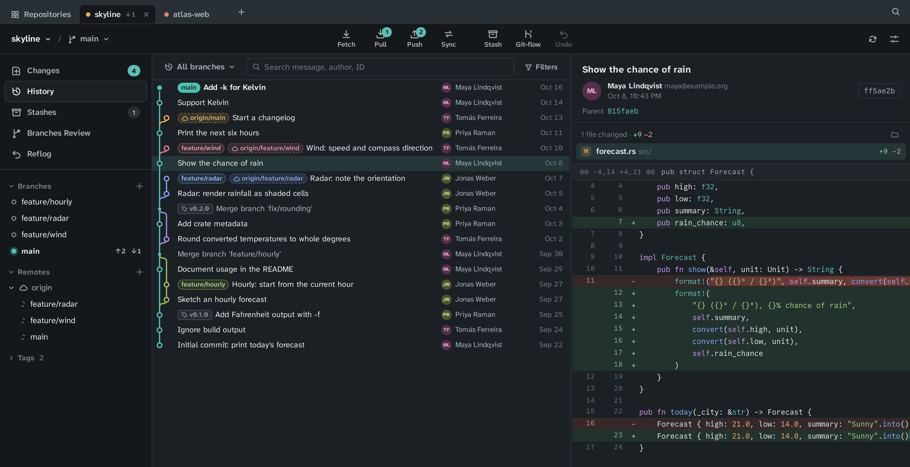
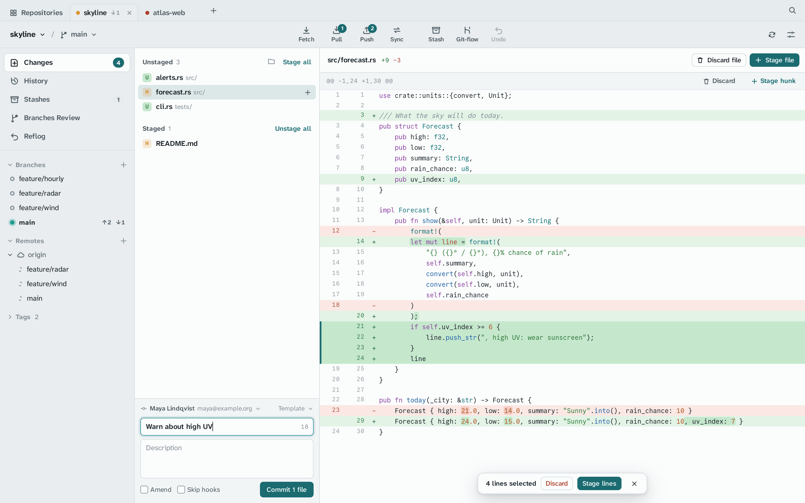
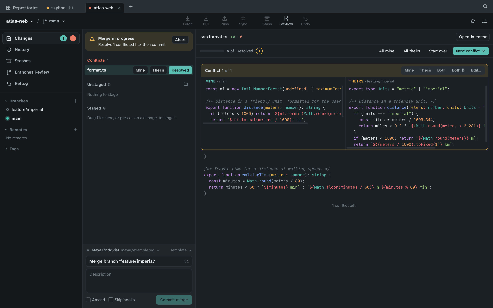
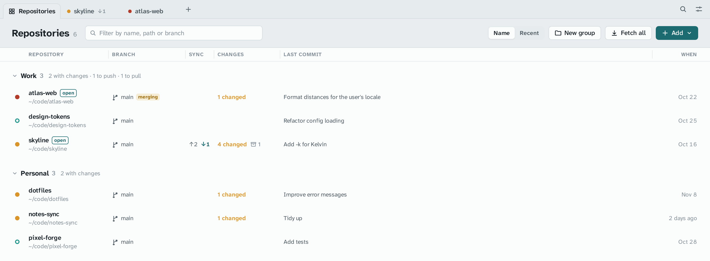
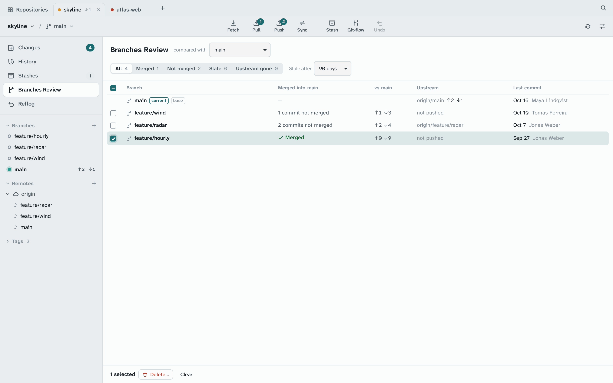
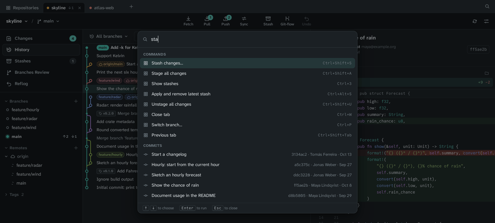
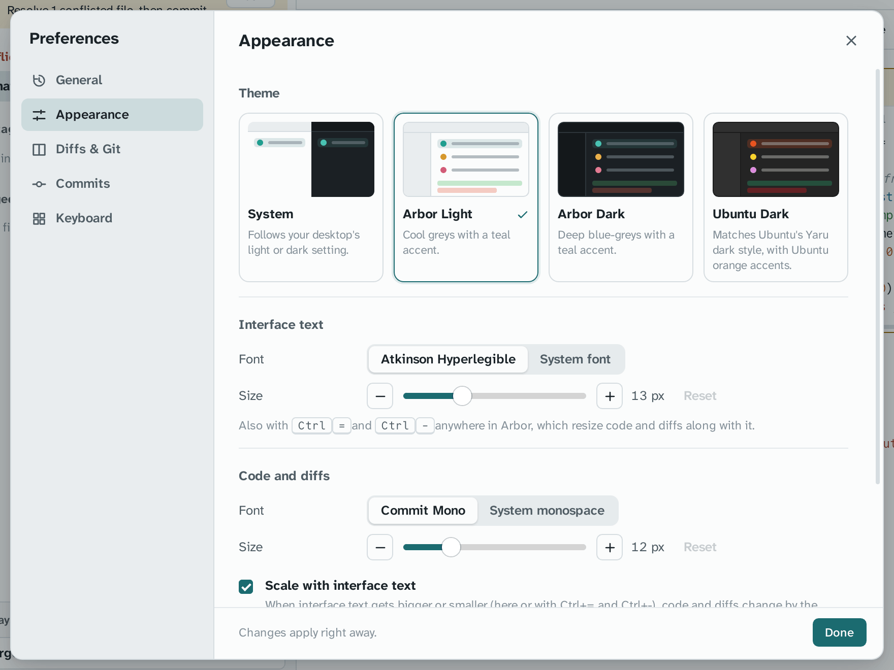

<p align="center">
  
</p>

<h1 align="center">Arbor</h1>

<p align="center">
  A friendly, fast Git client for <b>Linux, macOS, Windows and FreeBSD</b>.<br>
  Drag-and-drop merging, line-by-line staging, a real conflict wizard, and an undo button that covers almost everything.
</p>

<p align="center">
  <a href="https://github.com/bmickov/Arbor/releases/latest"></a>
  <a href="https://github.com/bmickov/Arbor/actions/workflows/ci.yml"></a>
  
  <a href="LICENSE"></a>
</p>

<p align="center">
  <a href="https://github.com/bmickov/Arbor/releases/latest"><b>Download</b></a> ·
  <a href="#a-quick-tour">Tour</a> ·
  <a href="#features">Features</a> ·
  <a href="#keyboard">Keyboard</a> ·
  <a href="#build-from-source">Build from source</a>
</p>



Arbor is an original app, free and open source under the GPL. It's inspired by
the workflows that make Tower pleasant, but isn't affiliated with Tower or
fournova and contains none of their code or artwork.

## Why Arbor

- **Stage exactly what you mean.** Whole files, single hunks or individual
  lines: click, shift-click or drag across a diff, then stage or discard.
- **Undo almost anything.** Commits, merges, rebases, resets, discards (even of
  new files), branch and stash operations: Ctrl+Z puts them back.
- **Drag and drop.** Drop a branch on another to merge or rebase, on a remote to
  push; drag commits to reorder them or onto your branch to cherry-pick.
- **Conflicts without fear.** Each conflict side by side, mine against theirs,
  with one click per side. Arbor tells you a merge will conflict *before* you start.
- **Fast on big repositories.** History, blame and file lists load a page at a
  time, and diffs with millions of lines still scroll smoothly.
- **Everywhere you work.** Native installers for Windows, macOS (Apple silicon
  and Intel), Linux (.deb, .rpm, AppImage, x64 and arm64) and FreeBSD.

## A quick tour

### Stage lines, not just files

Select the lines you want in any diff and stage or discard just those. The
commit composer remembers your draft, knows your templates, and shows who
you're committing as.



### Resolve conflicts side by side

Every conflict in a file, your version beside theirs (and the common base when
you want it). Pick a side, take both in either order, or write the result
yourself, then mark the file resolved and commit the merge.



### All your repositories at a glance

Group your repositories, see which ones have changes, commits to push or pull,
stashes or a merge in progress, and fetch them all at once.



### Tidy up branches

Branches Review lists every local branch with whether it's merged (including
squash and rebase merges), how far it's ahead and behind, and whether its
remote branch still exists. Select and delete in bulk; one Undo restores them.



### Do anything from the keyboard

Quick Actions (Ctrl+Shift+P or Ctrl+K) searches commands, branches, commits,
files and repositories in one box. Every shortcut can be changed.



### Make it yours

Light and dark themes (or follow your desktop), an Ubuntu-style dark theme,
and adjustable fonts and sizes for the interface and for code.

<p align="center">
  
</p>

## Download

Get the latest version from the [**Releases page**](https://github.com/bmickov/Arbor/releases/latest):

| System | File |
| --- | --- |
| **Windows** 10 and 11 | `Arbor_<version>_x64-setup.exe` (or the `.msi`) |
| **macOS** 10.15+, Apple silicon and Intel | `Arbor_<version>_universal.dmg` |
| **Debian, Ubuntu, Mint, Pop!_OS** | `Arbor_<version>_amd64.deb` / `_arm64.deb` |
| **Fedora, openSUSE, RHEL** | `Arbor-<version>-1.x86_64.rpm` / `.aarch64.rpm` |
| **Any Linux** | `Arbor_<version>_amd64.AppImage` / `_aarch64.AppImage` |
| **FreeBSD** 14+ | `Arbor_<version>_freebsd_amd64.tar.gz` |

```sh
# Debian/Ubuntu                 # Fedora/openSUSE
sudo apt install ./Arbor_*.deb  sudo dnf install ./Arbor-*.rpm

# AppImage
chmod +x Arbor_*.AppImage && ./Arbor_*.AppImage

# FreeBSD
pkg install webkit2-gtk_41 git
tar xzf Arbor_*_freebsd_amd64.tar.gz && cd arbor-* && doas ./install.sh
```

The AppImage adds Arbor to your applications menu the first time it runs
(a launcher in `~/.local/share/applications` and icons in
`~/.local/share/icons`), so the dock and task switcher show its name and
icon. It follows the AppImage if you move it or switch versions; turn it off
in Preferences → General to remove it. The .deb and .rpm install their own.

The builds aren't signed with a paid certificate, so the first launch asks
you to confirm: on **macOS**, open System Settings → Privacy & Security and
choose *Open Anyway*; on **Windows**, choose *More info → Run anyway*. Each
release lists SHA-256 checksums in `SHA256SUMS.txt`.

Want the very latest? Every commit to `main` is built for every platform by
[GitHub Actions](https://github.com/bmickov/Arbor/actions/workflows/ci.yml):
open a run and download the installers under *Artifacts* (you need to be
signed in to GitHub).

Run `arbor /path/to/repo` to open a repository directly in a new tab.
Without an argument, Arbor picks up where you left off (unless that's turned off).

Settings live in your system's config folder: `~/.config/arbor` on Linux and
the BSDs, `~/Library/Application Support/arbor` on macOS, and
`%APPDATA%\arbor` on Windows.

## Features

Click a group to expand it.

<details>
<summary><b>Quick Actions</b></summary>

- Ctrl+Shift+P (or Ctrl+K) opens one search box for everything: run any
  command, check out a branch, jump to a tag or commit (by message, author or
  ID), open a file's history, or switch repository

</details>

<details>
<summary><b>Many repositories</b></summary>

- A repository manager (Ctrl+T) lists every repository you've added, with its
  branch, commits to push and pull, uncommitted changes, stashes and latest commit
- Organise repositories into groups by dragging them; rename or reorder groups
- "Find repositories in a folder" scans something like `~/code` and adds
  everything inside it in one go, optionally as a group
- Fetch all repositories (or one group) at once
- The list is a table that fills the window: repository, branch, commits to
  push and pull, changes and stashes, the last commit's message and when it
  was made. Drag the edges in the header to resize columns (double-click to
  fit them again); the commit message takes whatever room is left
- Keyboard: arrow keys move through the list (Shift extends the selection),
  Enter opens, Space selects, Ctrl+A selects all, Delete removes from the list
  after asking. Select with Ctrl+click or Shift+click; a bar at the bottom
  opens or removes the selection
- Open repositories in tabs; each tab keeps its own view, selection and history
  position
- Folders that moved or were deleted are flagged, with Locate… and Remove

</details>

<details>
<summary><b>Resizable panels</b></summary>

- Drag any divider: the sidebar, file lists, the commit composer, the stash,
  reflog, compare and file-browser lists, the split between a commit's
  details and its diff, and the columns of the repository list. Double-click
  a divider to reset it; sizes are saved

</details>

<details>
<summary><b>Pick up where you left off</b></summary>

- When you quit and start Arbor again, it reopens your tabs on the same tab,
  and each one comes back on the same view (Changes, History or Stashes), with
  the same selected commit, file or stash, history search, branch filter and
  scroll position
- The sidebar width and hidden state, the history split, expanded sidebar
  sections, and the window's size, position and maximised state come back too
- On by default; turn it off in Preferences → General to start on the
  repository list every time

</details>

<details>
<summary><b>Working copy</b></summary>

- Stage, unstage or discard whole files, single hunks, or individual lines
  (click a line, shift-click or drag to extend, ctrl-click to toggle)
- Drag files between the Unstaged and Staged lists
- Commit composer with amend, skip-hooks, and a per-repo saved draft
- **Commit templates**: saved message templates (Preferences → Commits), plus
  the repository's own `commit.template`, from the Template menu
- **Author profiles**: see who you're committing as, and switch per repository
  (for example work and personal) from the name above the message
- Ignore a file, all files of its type, or its folder; stop tracking a file
  while keeping it on disk
- **Patches**: save uncommitted changes or any commit as a `.patch` file
  (commits in `git format-patch` format), and apply patch files. Applying an
  emailed patch puts its message in the commit box
- **Partial stash**: right-click files and "Stash … (only these)" puts just
  those changes aside; everything else stays as it is. Stashes can be named
  and include new files, and apply even while other changes are staged
- Runs your `pre-commit`, `commit-msg` and `post-commit` hooks (respects `core.hooksPath`)
- **Conflict wizard**: every conflict in a file side by side, mine against
  theirs (and the common base). Click a side to use it, take both in either
  order, or write the result yourself, then save and mark the file resolved.
  Works with half-edited files, and "Start over" merges the file afresh. Files
  deleted on one side, or binary, get a keep-mine or keep-theirs choice
- **Signed commits** with GPG or SSH keys (Preferences → Commits, for one
  repository or all), using Git's own settings, so the command line agrees.
  Each commit can opt out. Merges, cherry-picks, reverts and rewritten commits
  are signed too

</details>

<details>
<summary><b>History</b></summary>

- Commit graph for all branches, the current branch, or any single branch
- Commit details with per-file diffs, unified or side by side, and image previews
- **Changed words** are highlighted inside changed lines, so a one-character
  edit in a long line is easy to spot
- **Image diffs**: side by side, a swipe slider, onion skin (fade between
  them) or the pixel difference, with the image sizes
- Changed files as a **folder tree** or a flat list (the folder button above
  the list), in the working copy and in commit details; stage a whole folder
- **Issue links**: issue keys in commit messages (like `ENR-194`) link to
  your tracker; set the pattern in Preferences → Commits (Jira and Linear
  presets). `#123` links to the issue automatically for GitHub, GitLab and
  Codeberg remotes
- **Syntax highlighting** in diffs, the file browser and the conflict wizard,
  for about 50 languages (turn it off in Preferences → Diffs & Git)
- Signature checks: signed commits show **Verified** when the key is trusted
  (your GPG keyring, or `gpg.ssh.allowedSignersFile` for SSH), **Signed** when
  it can't be confirmed, and **Bad signature** when it doesn't match
- Diffs of any size: a file with hundreds of thousands or millions of changed
  lines opens in a second or two and scrolls smoothly, and you can still stage
  single lines deep inside it. (In very large side-by-side diffs, long lines
  are cut off instead of wrapped; switch to unified to scroll sideways.)
- Diffs with more than 10,000 changed lines (often generated or lock files)
  show a summary and a **Show diff** button instead of loading right away.
  The limit is in Preferences → Diffs & Git, including "Always show"
- File history (follows renames) and blame
- Restore any file to how it was in a commit, or just before it
- **Browse files** at any commit, branch or tag: a folder tree with a fast file
  viewer (even for huge files), and **Export as ZIP**
- **Find in files**: search every file's contents at that commit, branch or
  tag (plain text or a regular expression, optionally case-sensitive); click a
  match to open the file at that line
- **Compare branches**: the commits each side has that the other doesn't, and
  every file the branch would change, with one-click merge. It also tells you
  whether merging would conflict, and in which files, before you try
- **Reflog**: everywhere HEAD or a branch pointed recently. Commits that are on
  no branch any more (after a reset, rebase or deleted branch) are marked
  *lost*; **Recover as new branch** brings them back
- **Rebase, cherry-pick and revert pause on conflicts** instead of giving up:
  resolve them in the conflict wizard, then **Continue**, **Skip commit** or
  **Abort** from the banner (a rebase shows which commit it's on, "2 of 5").
  The branch only moves when the rebase finishes, and one Undo reverts it all
- **History filters** (the Filters button): author, a time range, a file or
  folder, and "changes containing" some text (like `git log -S`). They search
  the whole history, not just the loaded commits
- Right-click a commit to check out, branch, tag, cherry-pick, revert, reset,
  edit its message, squash or fixup into its parent, or remove it
- **Fold staged changes into an earlier commit**: right-click any commit on
  your branch → "Fold staged changes into this commit…". The commits after it
  are replayed on top, and your unstaged changes and new files aren't touched
- **Drag a commit up or down to reorder it**
- "Rewrite from here…" opens an interactive rebase editor: reorder by drag,
  then keep, edit message, squash, fixup or remove each commit

</details>

<details>
<summary><b>Branches and remotes</b></summary>

- Select several branches with Ctrl+click or Shift+click and delete them at
  once. One confirmation lists them, flags any with unmerged commits (with a
  "Delete only merged" choice), and one Undo brings them all back
- **Drag a branch onto another branch** to merge or rebase
- **Drag a branch onto a remote** to push it there
- Drag a commit onto the current branch to cherry-pick it
- **Conflict prediction**: merging or rebasing a branch that would conflict
  says so first, listing the files, so you can cancel or go ahead
- Fetch (with prune), pull (merge or rebase), push with rejection handling
- **Sync**: pull, then push, in one click
- **Pull requests**: "Create pull request…" on any branch opens the page that
  starts one on GitHub, GitLab (merge requests), Bitbucket, Codeberg, Gitea,
  Forgejo or Azure DevOps, aimed at main (or the branch it's stacked on),
  pushing it first if needed. Publishing a new branch offers it too
- **Open on GitHub** (or GitLab, Bitbucket…): the repository, a branch, a
  commit, or a file as it was in a commit; the repository menu also links to
  its pull requests
- Remotes with a separate push URL (`remote.<name>.pushurl`) push there
- **Fetch automatically** in the background (every 10 minutes by default), so
  the counts of commits to pull stay current, with a desktop notification when
  new commits arrive for a branch (turn it off in Preferences → Diffs & Git)
- **Safe force push**: force pushes check the remote first, like
  `--force-with-lease`, and refuse if someone pushed since your last fetch
- SSH via ssh-agent or `~/.ssh/id_*` keys; HTTPS via your git credential helper,
  or a username and token prompt
- Clone, init, add and remove remotes, track upstream branches, push and delete tags
- **Repository settings** (the repository menu): rename remotes and change
  their fetch and push URLs, edit `.gitignore` (with common patterns for
  macOS, Windows, editors, Node, Rust, Python and PHP), and see every git
  setting that applies, where it comes from, and change this repository's own

</details>

<details>
<summary><b>Git-flow, stacked branches and bisect</b></summary>

- **Git-flow** (toolbar button): set it up once, then start and finish
  features, releases and hotfixes. Finishing merges with a merge commit,
  tags releases and hotfixes on the production branch and merges them back
  into develop, and deletes the branch. If a merge conflicts, resolve and
  commit it, then finish again: it carries on where it stopped. Uses
  git-flow's own settings, so the git-flow command line agrees
- **Stacked branches**: mark a branch as built on another (in the New branch
  dialog, or "Stack on another branch…" in its menu). It's shown under its
  parent, with a **restack** badge when the parent has new commits; restack
  replays just its own commits on the parent, even after the parent was
  rewritten. "Restack … and branches on it" does a whole stack
- **Bisect**: right-click a commit that works → "Find the bad commit after
  this…". Arbor checks out commits in between; mark each **Good**, **Bad** or
  **Skip** until it names the first bad commit. Uses git's own bisect state

</details>

<details>
<summary><b>External tools, pinned branches and Git LFS</b></summary>

- **External diff and merge tools**: Meld, Visual Studio Code, Beyond
  Compare, KDiff3, P4Merge, Kaleidoscope, WinMerge or Kompare, git's own
  difftool/mergetool settings, or any command (`$LOCAL $REMOTE $BASE
  $MERGED`). "Open in diff tool" on any changed file or commit file; "Open
  in merge tool" on a conflict, then mark it resolved when the tool closes
- **Pinned branches**: "Pin to top" on any local or remote branch keeps it
  in a Pinned section at the top of the sidebar
- **Git LFS**: files tracked with LFS are staged as LFS pointers (through
  git), and get their real contents back after every checkout, pull, merge,
  rebase or stash. The sidebar lists tracked patterns, how many files still
  need downloading, and file locks (lock and unlock from a file's menu).
  "Track *.ext with LFS" on any file. Needs git-lfs installed

</details>

<details>
<summary><b>Worktrees and submodules</b></summary>

- **Worktrees**: check out a branch in its own folder ("Check out in a new
  worktree…" on any branch, or New worktree in Quick Actions), so you can work
  on two branches at once. The sidebar lists them with uncommitted changes;
  click one to open it in a tab. Remove deletes the folder and keeps the branch;
  worktrees whose folder disappeared can be pruned
- **Submodules**: listed in the sidebar with their state (not cloned, at a
  different commit than recorded, or changed). Click to open one in a tab, or
  to clone it; Update checks out the recorded commits, recursively

</details>

<details>
<summary><b>Branches Review</b></summary>

- Every local branch in one table: merged into a base branch or not
  (including squash and rebase merges, which plain Git can't tell), commits
  ahead and behind, upstream status (flags branches whose remote branch was
  deleted), and when it was last touched
- Filter by merged, not merged, stale (30 days to a year) or upstream gone,
  select, and delete in bulk; one Undo restores them

</details>

<details>
<summary><b>Stashes</b></summary>

- Stash with a message, optionally including new files or keeping staged changes
- Apply, apply-and-remove, delete, or turn a stash into a branch
- **Snapshots** (right-click Stash, or the command palette): save every
  current change, new files included, as a stash while your working copy
  stays exactly as it is. "Go back to this point…" on any stash makes the
  working copy what it holds, saving where you are now as a snapshot first
- Select several stashes (Ctrl+click, Shift+click, Ctrl+A) and delete them
  together with the Delete key or the Delete button. Deleting always asks
  first, and one Undo restores them all
- Drag a stash onto Changes to apply it

</details>

<details>
<summary><b>Undo</b></summary>

- Ctrl+Z undoes commits, amends, staging, discards (even of untracked files),
  merges, rebases, history rewrites, cherry-picks, reverts, resets, checkouts,
  branch and tag creation, deletion and renames, stash operations, and remote changes
- **Undo history**: right-click Undo to see recent operations and undo back
  to any of them in one go
- The undo history lives in `.git/arbor/undo.json`, so it survives restarts
- Undo refuses rather than guesses when the repository changed since the operation

</details>

<details>
<summary><b>Safety</b></summary>

- Merges, rebases and rewrites refuse to start over uncommitted changes, and
  offer to stash them, run the operation, and put them back
- Rebases are replayed in memory, and the branch only moves when they finish:
  abort a paused rebase and everything is as it was
- Rewriting commits that are already pushed asks for confirmation first

</details>

## Preferences

Open with **Ctrl+,** or the sliders button.

- **General:** pick up where you left off (on by default); on Linux and the
  BSDs, add Arbor to the applications menu (on by default, for AppImages)
- **Theme:** System (follows your desktop), Arbor Light, Arbor Dark, or
  **Ubuntu Dark**, which matches Ubuntu's Yaru dark style with Ubuntu orange accents
- **Interface text:** Atkinson Hyperlegible or your system font, 10–20 px
- **Code and diffs:** Commit Mono or your system monospace font, 9–22 px.
  By default code scales along with the interface text, keeping the size
  difference you set; turn off "Scale with interface text" to keep it fixed.
  History rows and the graph scale with the interface size
- **Diffs & Git:** context lines, when to ask before showing large diffs,
  syntax highlighting, changed-word highlighting, external diff and merge
  tools, ignore whitespace, side-by-side history diffs, how often to fetch
  automatically, pull with rebase
- **Commits:** commit templates, author profiles, issue-tracker links, and
  commit signing
- **Keyboard:** every shortcut below can be changed. Click it and press new keys;
  if another action used them, it's unassigned and you're told which

## Keyboard

<details>
<summary>All keyboard shortcuts</summary>

On macOS, Ctrl in the table below is ⌘ (Command), Alt is ⌥ and Shift is ⇧.

| Keys | Action |
| --- | --- |
| Ctrl+Shift+P, Ctrl+K | Quick Actions: search commands, branches, commits, files… |
| Ctrl+Q | Quit (saves your tabs and window first) |
| F11 | Full screen |
| Ctrl+, | Preferences |
| Ctrl+/, F1 | Show keyboard shortcuts |
| Ctrl+T | Show all repositories |
| Ctrl+O | Open a repository |
| Ctrl+Shift+O | Clone a repository |
| Ctrl+Shift+E | Show the repository in your file manager |
| Ctrl+Shift+` | Open a terminal in the repository |
| Ctrl+W | Close tab |
| Ctrl+Shift+T | Reopen the last closed tab, as it was |
| Ctrl+Tab, Ctrl+PageDown / Ctrl+Shift+Tab, Ctrl+PageUp | Next / previous tab |
| Ctrl+Shift+PageUp / Ctrl+Shift+PageDown | Move the tab left / right |
| Alt+1 … Alt+9 | Go to tab 1–8, or the last tab |
| Ctrl+1 / 2 / 3 | Changes / History / Stashes |
| Ctrl+4 / 5 | Branches Review / Reflog |
| Ctrl+P | Switch branch (type to filter, or to create a new one) |
| Ctrl+B | New branch |
| Ctrl+F | Search history (on the repository list: filter it) |
| Ctrl+Shift+C | Copy the selected commit's ID |
| Ctrl+Enter | Commit |
| Ctrl+M | Write commit message |
| Ctrl+Shift+A / Ctrl+Shift+U | Stage all / unstage all |
| Ctrl+Shift+S / Ctrl+Alt+S | Stash / apply and remove the latest stash |
| Ctrl+Shift+F | Fetch (on the repository list: fetch all) |
| Ctrl+Shift+↓ / Ctrl+Shift+↑ | Pull / push |
| Ctrl+Shift+Y | Sync (pull, then push) |
| Ctrl+Z | Undo the last operation |
| Ctrl+R, F5 | Refresh |
| Ctrl+= / Ctrl+- / Ctrl+0 | Larger / smaller / reset text (code and diffs follow, unless turned off) |
| Ctrl+Alt+= / Ctrl+Alt+- | Larger / smaller code text |
| Ctrl+Shift+D | Side-by-side diffs in history |
| Ctrl+\\ | Show or hide the sidebar |

</details>

## Build from source

You need [Rust](https://rustup.rs) (1.80 or newer), [Node.js](https://nodejs.org)
20 or newer, Git, and the system libraries Tauri uses:

| System | Install first |
| --- | --- |
| Debian/Ubuntu | `sudo apt install build-essential libssl-dev libwebkit2gtk-4.1-dev librsvg2-dev patchelf` |
| Fedora | `sudo dnf install gcc openssl-devel webkit2gtk4.1-devel librsvg2-devel` |
| Arch | `sudo pacman -S base-devel openssl webkit2gtk-4.1 librsvg` |
| macOS | Xcode command line tools: `xcode-select --install` |
| Windows | [Visual Studio Build Tools](https://visualstudio.microsoft.com/visual-cpp-build-tools/) with "Desktop development with C++"; WebView2 is part of Windows 10/11 |
| FreeBSD | `pkg install rust node npm pkgconf webkit2-gtk_41 librsvg2-rust` |

```sh
npm install
npm run tauri dev      # run with hot reload
npm run tauri build    # installers in src-tauri/target/release/bundle
```

On FreeBSD (and other BSDs), Tauri's CLI isn't available, so build the web UI
with `npm run build` and then run `sh scripts/package-freebsd.sh`, which
compiles the app and makes a tarball in `dist-bundles/`.

Backend tests run against throwaway repositories (they need the `git` command):

```sh
cd src-tauri && cargo test
```

### Continuous integration and releases

Everything is built by [GitHub Actions](https://github.com/bmickov/Arbor/actions)
from the workflows in `.github/workflows`:

- **CI** (`ci.yml`) runs on every push to `main` and every pull request: type
  checks, the backend tests on Linux, macOS and Windows, then builds the
  installers for every platform (`build.yml`): Windows x64 (`.exe` and
  `.msi`), macOS universal (`.dmg`), Linux x64 and arm64 (`.deb`, `.rpm`,
  AppImage) and FreeBSD x64 (`.tar.gz`). Each run keeps them as downloadable
  *Artifacts* for 90 days.
- **Releases** (`release.yml`): bump the version in `package.json`,
  `src-tauri/Cargo.toml` and `src-tauri/tauri.conf.json`, run `cargo check` in
  `src-tauri` so `Cargo.lock` picks up the new version, commit, and push a
  matching tag. The workflow checks the versions match, builds everything and
  publishes a GitHub release with all installers and a `SHA256SUMS.txt`:

  ```sh
  git tag v0.16.0 && git push origin main v0.16.0
  ```

  Tags with a suffix (`v0.16.0-beta.1`) are published as pre-releases. If
  a platform's build fails or times out, the release is published with the
  others and its notes say what's missing; to add it later, run the Release
  workflow by hand from the Actions tab and enter the same tag.
- **Code signing** is optional. macOS builds are ad-hoc signed; to sign and
  notarize with an Apple Developer ID, add the repository secrets listed in
  `build.yml`.

## How it's built

- `src-tauri/src/git/` — all Git logic, on libgit2 via the `git2` crate
  (`vendored-libgit2`, so it doesn't depend on the system's libgit2 version).
  Each module is stateless: it opens the repository, does one job, returns data.
- `src-tauri/src/lib.rs` — Tauri commands; libgit2 work runs on worker threads
- `src/` — Svelte 5 UI. `lib/state.svelte.ts` holds app state and the `run()`
  wrapper (busy state, errors, auth prompts, auto-stash, refresh);
  `lib/actions.ts` holds user-facing operations; `lib/drag.svelte.ts` is a
  pointer-based drag-and-drop layer (HTML5 drag-and-drop is unreliable in WebKitGTK).
- `src-tauri/src/platform.rs` and `src/lib/platform.ts` — the few things that
  differ between operating systems (opening files and terminals, running hooks
  on Windows, shortcut labels and paths).

## Known limits

- Signing uses the `gpg` and `ssh-keygen` programs, like Git. An SSH key with
  a passphrase needs to be in ssh-agent; GnuPG asks in its own window.
- A rebase paused by Arbor is Arbor's own (Continue/Skip/Abort in Arbor);
  `git rebase --continue` doesn't know about it. Cherry-picks and reverts use
  git's own state, so the command line can finish those too.
- Rebasing across merge commits isn't supported.
- LFS needs `git` and `git-lfs` installed, since libgit2 can't run the LFS
  filter itself. Adding or removing submodules is
  left to the git CLI (listing, cloning, updating and opening them works).
- Pull requests are opened on the hosting site's own page; Arbor doesn't list
  or review them inside the app.
- On Windows, Git hooks run through Git for Windows' `sh`, so hooks need
  [Git for Windows](https://git-scm.com) to be installed.
- Other BSDs (OpenBSD, NetBSD) should build the same way as FreeBSD with
  `scripts/package-freebsd.sh`, but only FreeBSD is built and tested by CI.

## License

Copyright (C) 2026 The Arbor authors

Arbor is free software: you can redistribute it and/or modify it under the
terms of the [GNU General Public License](LICENSE) as published by the Free
Software Foundation, either version 3 of the License, or (at your option) any
later version.

Arbor is distributed in the hope that it will be useful, but WITHOUT ANY
WARRANTY; without even the implied warranty of MERCHANTABILITY or FITNESS FOR
A PARTICULAR PURPOSE. See the GNU General Public License for more details.

In short: you may use, share and change Arbor freely, but if you distribute
it, or a modified version, you must do so under the same license and make the
source code available. The fonts and libraries it bundles have their own
licenses, all compatible with the GPL; see
[THIRD_PARTY_NOTICES.md](THIRD_PARTY_NOTICES.md).

Contributions are welcome. By sending a pull request you agree to license
your contribution under the same terms.
